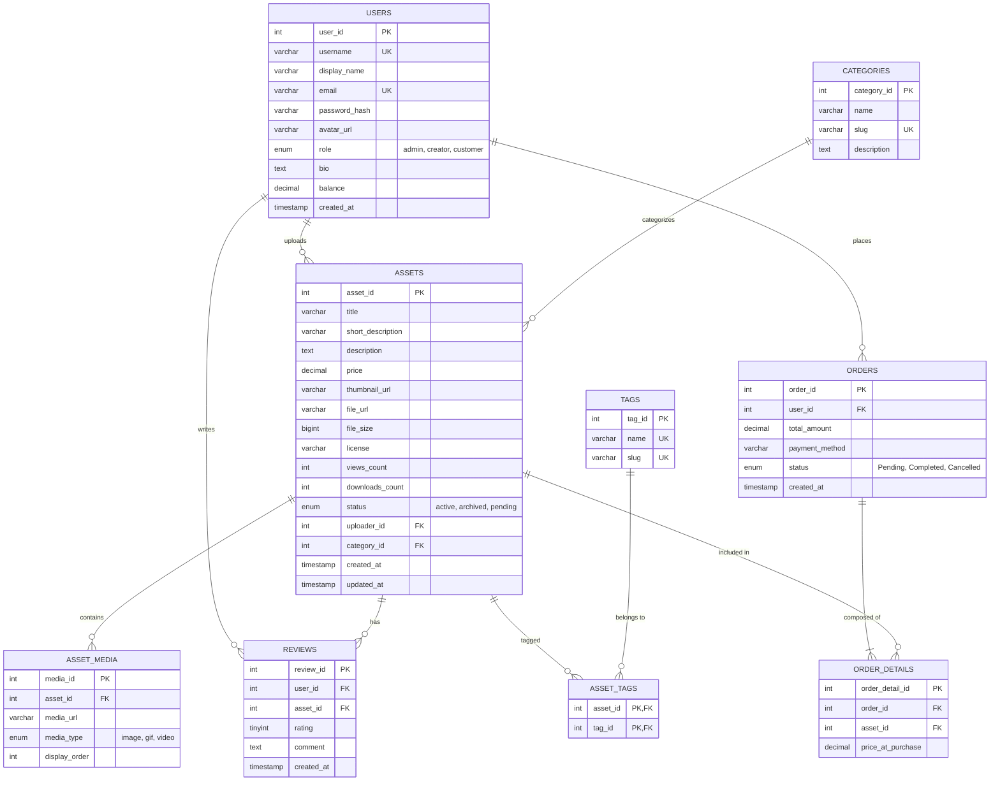

# TÀI LIỆU ĐẶC TẢ YÊU CẦU & KIẾN TRÚC TOÀN DIỆN HỆ THỐNG
# MASTER SYSTEM SPECIFICATION & ARCHITECTURAL BLUEPRINT
## DỰ ÁN: SÀN QUẢN LÝ VÀ GIAO DỊCH TÀI NGUYÊN TRÒ CHƠI TRỰC TUYẾN (GAME ASSET MARKETPLACE)

> **Học phần:** Thiết kế Web Nâng Cao — Trường Công nghệ Thông tin, Đại học Phenikaa (Phenikaa University)  
> **Giảng viên hướng dẫn:** ThS. Nguyễn Lệ Thu  
> **Nhóm thực hiện:** Nhóm 02 — Lớp Thiết kế Web Nâng Cao  
> **Kho lưu trữ chính thức (Repository):** [https://github.com/itcoder2k/ITWebNC-NO2](https://github.com/itcoder2k/ITWebNC-NO2)  
> **Mục tiêu tài liệu:** Đây là tài liệu đặc tả kỹ thuật, kiến trúc phần mềm, quy chuẩn cơ sở dữ liệu và yêu cầu nghiệp vụ toàn diện nhất của dự án. Mọi lập trình viên và thành viên nhóm khi tham gia phát triển bắt buộc phải đọc và tuân thủ nghiêm ngặt các quy chuẩn trong tài liệu này.

---

## 1. THÔNG TIN DỰ ÁN & PHÂN CÔNG TRÁCH NHIỆM 4 TẦNG

Dự án áp dụng mô hình **Kiến trúc phân lớp 4 tầng (4-Tier Layered Architecture)**. Mỗi thành viên trong nhóm chịu trách nhiệm độc lập và trọn vẹn từ tầng giao diện, tầng nghiệp vụ đến tầng truy xuất dữ liệu:

| STT | Họ và Tên | Mã Sinh Viên | Vai trò | Phân hệ phụ trách chính | Các lớp triển khai cụ thể theo Kiến trúc 4 tầng |
| :---: | :--- | :---: | :---: | :--- | :--- |
| **1** | **Nguyễn Trọng Hùng** | **`23010083`** | **Nhóm trưởng** | **`User`** (Người dùng & Ví tiền)<br>& **`Auth`** (Xác thực bảo mật JWT / RBAC) | • **Presentation:** `user.controller.ts`, `auth.controller.ts`<br>• **Business Logic:** `user.service.ts`, `auth.service.ts`<br>• **Data Access:** `user.provider.ts` (Inject `DATA_SOURCE`)<br>• **Entity & DTO:** `user.entity.ts`, `deposit.dto.ts`, `create-user.dto.ts`, `update-user.dto.ts` |
| **2** | **Nguyễn Hữu Hưng** | **`23010124`** | **Thành viên** | **`Tag`** (Thẻ gắn đa tiêu chí)<br>& **`AssetMedia`** (Demo Gallery) | • **Presentation:** `tag.controller.ts`<br>• **Business Logic:** `tag.service.ts`<br>• **Data Access:** `tag.provider.ts`, `asset-media.provider.ts`<br>• **Entity & DTO:** `tag.entity.ts`, `asset-media.entity.ts`, `asset-tags.entity.ts` |
| **3** | **Nguyễn Mạnh Thắng** | **`23010098`** | **Thành viên** | **`Category`** (Danh mục phân loại)<br>& **`DatabaseModule`** (Cấu hình CSDL) | • **Presentation:** `category.controller.ts`<br>• **Business Logic:** `category.service.ts`<br>• **Data Access:** `category.provider.ts`, `database.providers.ts`<br>• **Entity & DTO:** `category.entity.ts`, TypeORM DataSource |
| **4** | **Vũ Quốc Toản** | **`23010003`** | **Thành viên** | **`Asset`** (Tài nguyên Game),<br>**`Order`** (Đơn hàng) & **`Review`** | • **Presentation:** `asset.controller.ts`, `order.controller.ts`, `review.controller.ts`<br>• **Business Logic:** `asset.service.ts`, `order.service.ts`, `review.service.ts`<br>• **Data Access:** `asset.provider.ts`, `order.provider.ts`, `review.provider.ts`<br>• **Entity & DTO:** `asset.entity.ts`, `order.entity.ts`, `order-detail.entity.ts`, `review.entity.ts` |

---

## 2. TỔNG QUAN HỆ THỐNG & ĐẶC TẢ NGHIỆP VỤ CỐT LÕI

### 2.1. Định vị sản phẩm
Dự án là nền tảng thương mại điện tử C2C & B2C chuyên biệt cho việc quản lý, phân phối và giao dịch tài nguyên kỹ thuật số phục vụ phát triển game (Digital Game Assets):
* **Đồ họa 2D:** Spritesheets, Spine 2D Animations, Pixel Art Tilesets, Backgrounds.
* **Mô hình 3D:** Nhân vật, vũ khí, xe cộ, môi trường (.fbx, .obj, .blend, .gltf).
* **Âm thanh & Âm nhạc:** Hiệu ứng tiếng động (SFX), nhạc nền lặp (Looping BGM .wav, .ogg).
* **Giao diện & Phông chữ:** Game UI Kits, HUD, Vector Icons, Pixel Fonts.

### 2.2. Các đặc trưng nghiệp vụ cốt lõi (Core Business Features)
1. **Thư viện xem trước đa phương tiện (Media Preview Gallery):**
   * Khác với các trang bán hàng thông thường chỉ có 1 ảnh đại diện, mỗi tài nguyên game bắt buộc hỗ trợ bộ sưu tập gồm: nhiều ảnh chụp màn hình độ phân giải cao, ảnh động GIF mô tả hoạt họa chuyển động của nhân vật (chạy, nhảy, tấn công) và audio player nghe thử âm thanh trực tiếp.
2. **Hệ thống Thẻ gắn đa chiều (Multi-Dimensional Tag Engine):**
   * Cho phép lọc chéo tài nguyên theo: *Phong cách đồ họa* (`#pixel-art`, `#low-poly`, `#voxel`), *Góc nhìn game* (`#top-down`, `#side-scroller`, `#isometric`) và *Định dạng kỹ thuật* (`#animated`, `#seamless-texture`).
3. **Mô hình định giá Pay What You Want (PWYW - Trả giá tùy tâm):**
   * Tác giả (Creator) thiết lập mức giá sàn tối thiểu (Minimum Price): có thể là miễn phí ($0.00) hoặc có phí (ví dụ $5.00).
   * Người mua có quyền nhập số tiền lớn hơn giá sàn (ví dụ trả $10.00 thay vì $5.00) để donate, khích lệ tinh thần người sáng tạo.
4. **Bảo mật tệp tải xuống (Protected Download Streaming):**
   * Tệp nén gốc (.zip, .rar) chứa source code / asset hoàn chỉnh được lưu trữ tại thư mục bảo vệ trên server. Tuyệt đối không public link tệp tĩnh ra Internet để ngăn chặn tải lậu. Chỉ những tài khoản đã mua hợp lệ hoặc file miễn phí mới được server cấp luồng stream file về máy.
5. **Thanh toán nội bộ tức thì qua Ví điện tử (Wallet Balance):**
   * Người dùng nạp tiền vào ví cá nhân (`balance`) và thanh toán đơn hàng một chạm. Mọi giao dịch được đảm bảo bằng **Database Transaction** chuẩn ACID.
6. **Thư viện cá nhân (My Library):**
   * Khi người dùng đã mua hoặc nhận tài nguyên, sản phẩm được lưu vĩnh viễn vào Thư viện cá nhân của tài khoản để tải lại bất kỳ lúc nào mà không phải thanh toán lại.
7. **Đánh giá có xác thực (Verified Purchase Reviews):**
   * Chỉ những người dùng đã thực sự mua hoặc sở hữu tài nguyên trong thư viện mới có quyền chấm điểm 1-5 sao và viết nhận xét công khai.

---

## 3. CÔNG NGHỆ SỬ DỤNG (TECH STACK)

* **Backend:**
  * Framework: **NestJS 12** (Node.js ESM `"type": "module"`).
  * ORM: **TypeORM** kết nối hệ quản trị CSDL quan hệ **MySQL 8.0**.
  * Xác thực: **Passport.js + JWT (JSON Web Token)**, mã hóa mật khẩu bằng **bcrypt** (10 salt rounds).
  * Phân quyền: **RBAC (Role-Based Access Control)** với Custom Decorator `@Roles()` và `RolesGuard`.
  * Validation: **class-validator** và **class-transformer** kích hoạt toàn cục qua ValidationPipe.
* **Frontend:**
  * Thư viện: **React 19** (Single Page Application).
  * Điều hướng: **React Router DOM v7**.
  * HTTP Client: **Axios** (kèm Axios Request/Response Interceptors tự động gắn JWT Token và dọn phiên hết hạn).
  * Giao diện: Thiết kế tối ưu toàn màn hình (Full-Screen 2-Column Layout), phong cách phẳng, thanh lịch, nền trắng chữ đen với điểm nhấn màu đỏ san hô (#fa5c5c).
* **Quản lý mã nguồn:** Monorepo (`client/` và `server/`), kiểm soát phiên bản qua Git.

---

## 4. CẤU TRÚC THƯ MỤC DỰ ÁN (DIRECTORY STRUCTURE)

```text
ITWebNC-NO2/
├── README.md                       # Báo cáo tổng quan, phân công nhóm và hướng dẫn chạy nhanh
├── PROJECT_SPECIFICATION.md        # [TÀI LIỆU NÀY] Đặc tả kỹ thuật toàn diện của dự án
├── docs/                           # Thư mục tài liệu phân tích chi tiết
│   ├── ARCHITECTURE.md             # Kiến trúc 4 tầng, luồng JWT/RBAC, LocalStorage vs Cookie
│   ├── USE_CASES.md                # Biểu đồ Use Case Diagram & ma trận phân quyền 4 tác nhân
│   ├── SEQUENCE_DIAGRAMS.md        # Sơ đồ tuần tự: Đăng nhập, Nạp tiền ví, Mua PWYW
│   ├── DATABASE_DESIGN.md          # Lược đồ 9 bảng, sơ đồ lớp UML, giao dịch ACID
│   └── LEGAL_AND_ETHICS.md         # Báo cáo tuân thủ luật bảo vệ dữ liệu GDPR, Cookie Consent, Bản quyền
│
├── database/                       # Quản lý CSDL (schema.sql, seeds.sql, gameassets.sql)
│
├── client/                         # FRONTEND (React 19)
│   ├── public/                     # Static assets, index.html
│   ├── src/
│   │   ├── api/                    # axiosClient.js, authApi.js
│   │   ├── components/             # Layout (Navbar, Sidebar, Footer), Common (DepositModal, CookieConsent)
│   │   ├── context/                # AuthContext.jsx (quản lý state user, token, ví tiền toàn cục)
│   │   ├── pages/                  # HomePage, LoginPage, RegisterPage, ProfilePage
│   │   ├── routes/                 # ProtectedRoute.jsx
│   │   ├── styles/                 # theme.css (Design tokens, layout 2 cột full màn hình)
│   │   ├── App.js                  # Root Component & Routes
│   │   └── index.js
│   └── package.json
│
└── server/                         # BACKEND (NestJS 12 - Chuẩn Kiến trúc phân lớp 4 tầng)
    ├── src/
    │   ├── auth/                   # Module xác thực JWT, Bcrypt, Local/Jwt Strategy, Guards, Roles
    │   ├── user/                   # Module người dùng, hồ sơ cá nhân và ví điện tử (Chuẩn 4 tầng)
    │   ├── category/               # Module danh mục cấp cao
    │   ├── tag/                    # Module hệ thống thẻ gắn lọc chéo
    │   ├── asset/                  # Module tài nguyên game, upload media, download file gốc
    │   ├── order/                  # Module đơn hàng, thanh toán trừ ví ACID, thư viện cá nhân
    │   ├── review/                 # Module đánh giá sao có xác thực (Verified review)
    │   ├── database/               # Khởi tạo DATA_SOURCE TypeORM kết nối MySQL
    │   ├── app.module.ts           # Root module kết nối toàn bộ hệ thống
    │   └── main.ts                 # Bootstrap server (Port 5000, CORS, Global Prefix /api)
    ├── .env.example
    └── package.json
```

---

## 5. PHÂN TÍCH CHUYÊN SÂU KIẾN TRÚC PHÂN LỚP 4 TẦNG (4-TIER ARCHITECTURE)

Hệ thống tuân thủ nghiêm ngặt nguyên lý **Tách biệt mối quan tâm (Separation of Concerns - SoC)** và quy tắc phụ thuộc một chiều từ trên xuống dưới:

```
┌────────────────────────────────────────────────────────────────────────────────────────┐
│                      TẦNG 1: PRESENTATION LAYER (TẦNG TRÌNH DIỄN)                      │
│                                                                                        │
│  [Phía Client - React 19 SPA]      │  [Phía Server - NestJS Controllers]               │
│  • Components, Pages, Theme System │  • *.controller.ts                                │
│  • Axios Client & Interceptors     │  • Nhiệm vụ: Tiếp nhận HTTP Request (GET/POST/..),│
│  • AuthContext State Management    │    Validate dữ liệu đầu vào qua DTO/Pipes,        │
│                                    │    điều hướng đến Service và trả HTTP Response.   │
└───────────────────────────────────────────┬────────────────────────────────────────────┘
                                            │ DTOs (Data Transfer Objects đã được kiểm tra)
                                            ▼
┌────────────────────────────────────────────────────────────────────────────────────────┐
│                   TẦNG 2: BUSINESS LOGIC LAYER (TẦNG NGHIỆP VỤ / DỊCH VỤ)              │
│                                                                                        │
│  [Services - *.service.ts]                                                             │
│  • UserService, AuthService, AssetService, CategoryService, OrderService, ReviewService│
│  • Nhiệm vụ: Xử lý các quy tắc nghiệp vụ cốt lõi:                                      │
│    - Băm mật khẩu Bcrypt & sinh JWT Token đăng nhập                                    │
│    - Kiểm tra số dư ví & thực hiện giao dịch mua tài nguyên qua Database Transaction   │
│    - Kiểm tra quyền sở hữu tệp trước khi cho phép tải file                             │
│    - Kiểm tra điều kiện mua hàng thực tế trước khi cho phép đánh giá (Verified Review) │
└───────────────────────────────────────────┬────────────────────────────────────────────┘
                                            │ Dependency Injection (Repository Interface)
                                            ▼
┌────────────────────────────────────────────────────────────────────────────────────────┐
│                TẦNG 3: DATA ACCESS LAYER / PERSISTENCE (TẦNG TRUY XUẤT DỮ LIỆU)        │
│                                                                                        │
│  [Providers & Repositories - *.provider.ts]                                            │
│  • user.provider.ts, asset.provider.ts, order.provider.ts, ...                         │
│  • Nhiệm vụ: Đóng gói toàn bộ logic truy vấn CSDL. Sử dụng TypeORM `DATA_SOURCE`       │
│    để lấy Repository tương ứng của từng đối tượng:                                     │
│    `provide: 'USER_REPOSITORY', useFactory: (ds) => ds.getRepository(User)`           │
│  • Tách biệt hoàn toàn tầng Service khỏi chi tiết kỹ thuật của CSDL hoặc câu lệnh SQL.  │
└───────────────────────────────────────────┬────────────────────────────────────────────┘
                                            │ Object-Relational Mapping (ORM)
                                            ▼
┌────────────────────────────────────────────────────────────────────────────────────────┐
│               TẦNG 4: DATABASE & ENTITY LAYER (TẦNG THỰC THỂ & CƠ SỞ DỮ LIỆU)          │
│                                                                                        │
│  [Entities & Database Schema - *.entity.ts & MySQL Server]                             │
│  • Entities: User, Asset, AssetMedia, Category, Tag, Order, OrderDetail, Review        │
│  • Database Engine: Hệ quản trị CSDL quan hệ MySQL 8.0 (`GameAssetDB`)                 │
│  • Nhiệm vụ: Định nghĩa cấu trúc bảng (Table Schemas), khóa chính (PK), khóa ngoại     │
│    (FK), chỉ mục (Indexes) và đảm bảo tính toàn vẹn dữ liệu (ACID Transactions).        │
└────────────────────────────────────────────────────────────────────────────────────────┘
```

---

## 6. MÔ HÌNH CƠ SỞ DỮ LIỆU TOÀN DIỆN (DATABASE SPECIFICATION - 9 BẢNG)

### 6.1. Sơ đồ Thực thể Quan hệ (ERD Diagram)


### 6.2. Từ điển Dữ liệu Chi tiết (Data Dictionary):
1. **`users`:** Quản lý tài khoản, phân quyền (`customer`, `creator`, `admin`), mật khẩu băm Bcrypt và số dư ví điện tử cá nhân (`balance DECIMAL(10,2)`).
2. **`categories`:** Danh mục lớn (`category_id`, `name`, `slug`, `description`).
3. **`tags`:** Thẻ phân loại game (`tag_id`, `name`, `slug`).
4. **`assets`:** Thực thể trung tâm lưu thông tin tài nguyên game, mức giá sàn, loại giấy phép bản quyền, đường dẫn tệp gốc an toàn và số liệu thống kê (`views_count`, `downloads_count`).
5. **`asset_media`:** Gallery xem trước: Lưu nhiều ảnh screenshot, ảnh động GIF mô tả hoạt ảnh hoặc file âm thanh nghe thử (`media_url`, `media_type`, `display_order`).
6. **`asset_tags`:** Bảng liên kết nhiều-nhiều (N-N) phục vụ công cụ lọc chéo đa tiêu chí.
7. **`orders`:** Hóa đơn giao dịch mua tài nguyên hoặc nạp tiền ví điện tử (`total_amount`, `payment_method`, `status`).
8. **`order_details`:** Chi tiết từng tài nguyên trong đơn hàng, lưu snapshot giá tại thời điểm giao dịch (`price_at_purchase`).
9. **`reviews`:** Đánh giá sao từ 1 đến 5 sao và nhận xét phản hồi (Ràng buộc: `UNIQUE KEY (user_id, asset_id)`).

### 6.3. Tính Toàn vẹn & Giao dịch Dữ liệu (ACID Constraints):
* **Ràng buộc Xóa Creator:** Khóa ngoại `Assets.uploader_id` liên kết với `Users.user_id` có hành vi `ON DELETE SET NULL`. Khi xóa tài khoản Creator, Asset **không bị xóa** mà chuyển trạng thái sang `archived` để đảm bảo người mua trước đó vẫn tải lại được file bất kỳ lúc nào.
* **Giao dịch Mua bán Nguyên tử (Atomicity):** Trừ tiền ví người mua, cộng tiền ví người bán, tạo bản ghi `Orders` và `OrderDetails` diễn ra trong một **Database Transaction**. Bất kỳ bước nào gặp lỗi đều tự động Rollback.

---

## 7. ĐẶC TẢ BẢO MẬT & PHÂN QUYỀN (JWT & RBAC)

### 7.1. Cơ chế Xác thực (Authentication)
* **Băm mật khẩu 1 chiều:** Sử dụng thuật toán `bcrypt` với 10 salt rounds trước khi lưu vào CSDL.
* **Cấp phát JWT Token:** Khi đăng nhập thành công, Server sinh ra chuỗi `accessToken` ký số HMAC SHA-256 chứa payload:
  ```json
  {
    "sub": 14,
    "username": "buyer_hung",
    "role": "customer",
    "iat": 1791791914,
    "exp": 1791878314
  }
  ```
* **Đính kèm tự động phía Client:** Axios Request Interceptor tự động đọc token từ `localStorage` và gửi qua HTTP Header: `Authorization: Bearer <accessToken>`.

### 7.2. Cơ chế Phân quyền (Authorization - RBAC)
* Sử dụng Custom Decorator `@Roles()` kết hợp `RolesGuard` để kiểm tra quyền hạn trước khi request chạm vào Service:
  * **Customer (Khách mua):** Nạp tiền ví, mua tài nguyên, quản lý thư viện cá nhân, tải file đã mua, viết đánh giá.
  * **Creator (Nhà sáng tạo):** Kế thừa quyền Customer + Đăng bán tài nguyên mới, quản lý gallery demo, theo dõi doanh thu bán hàng.
  * **Admin (Quản trị viên):** Toàn quyền kiểm soát, quản lý người dùng, duyệt danh mục và quản trị toàn hệ thống.

---

## 8. DANH MỤC API RESTFUL TOÀN HỆ THỐNG (API SPECIFICATION)

Tiền tố chung (Global Prefix): **`/api`**. Header xác thực: `Authorization: Bearer <jwt_token>`.

### 8.1. Phân hệ Xác thực & Người dùng (`/api/auth`, `/api/users`)
* `POST /api/auth/register`: Đăng ký tài khoản mới (hỗ trợ chọn vai trò: `customer` hoặc `creator`).
* `POST /api/auth/login`: Đăng nhập bằng Username hoặc Email ➔ Trả về `accessToken` và thông tin `user`.
* `GET /api/auth/profile` `[Guarded]`: Xem thông tin tài khoản hiện tại kèm số dư ví.
* `GET /api/users`: Lấy danh sách toàn bộ người dùng `[Admin Only]`.
* `GET /api/users/:id`: Xem hồ sơ công khai của người dùng theo ID.
* `GET /api/users/profile` `[Guarded]`: Xem thông tin cá nhân của chính mình.
* `PUT /api/users/profile` `[Guarded]`: Cập nhật tên hiển thị, bio, avatar.
* `POST /api/users/wallet/deposit` `[Guarded]`: Nạp tiền vào ví điện tử cá nhân (cộng dồn số dư tức thì).

### 8.2. Phân hệ Danh mục & Thẻ gắn (`/api/category`, `/api/tag`)
* `GET /api/category`: Lấy danh sách toàn bộ danh mục cấp cao (2D, 3D, Audio, UI, VFX).
* `POST /api/category` `[Admin Only]`: Thêm mới danh mục.
* `GET /api/tag`: Lấy toàn bộ cây thẻ gắn.
* `GET /api/tag/popular`: Lấy danh sách các thẻ thịnh hành nhất (`#pixel-art`, `#low-poly`, `#animated`).

### 8.3. Phân hệ Tài nguyên Game (`/api/asset`)
* `GET /api/asset`: Lấy danh sách tài nguyên (hỗ trợ lọc theo category, tag, từ khóa, khoảng giá và sắp xếp).
* `GET /api/asset/:id`: Lấy chi tiết tài nguyên, danh sách media demo, thông tin tác giả và số liệu thống kê.
* `POST /api/asset` `[Creator/Admin]`: Đăng tải tài nguyên mới kèm tệp tin gốc và ảnh demo.
* `PUT /api/asset/:id` `[Owner/Admin]`: Chỉnh sửa thông tin tài nguyên và giá bán.
* `DELETE /api/asset/:id` `[Owner/Admin]`: Gỡ hoặc xóa tài nguyên.
* `GET /api/asset/:id/download` `[Guarded]`: Luồng tải file gốc an toàn (kiểm tra quyền sở hữu trước khi truyền luồng file).

### 8.4. Phân hệ Đơn hàng & Thư viện (`/api/order`)
* `POST /api/order/checkout` `[Guarded]`: Mua tài nguyên (hỗ trợ mô hình Pay What You Want, trừ tiền ví tự động trong Transaction).
* `GET /api/order/my-library` `[Guarded]`: Lấy danh sách toàn bộ game và tài nguyên mà người dùng đã sở hữu kèm quyền tải.
* `GET /api/order/history` `[Guarded]`: Lịch sử các đơn hàng của người dùng.
* `GET /api/order/:id` `[Guarded]`: Chi tiết đơn hàng theo mã ID.

### 8.5. Phân hệ Đánh giá (`/api/review`)
* `GET /api/review/asset/:id`: Lấy danh sách đánh giá sao và nhận xét của một tài nguyên.
* `POST /api/review` `[Guarded]`: Gửi đánh giá 1 - 5 sao (Ràng buộc: Chỉ người đã mua tài nguyên mới được đánh giá).

---

## 9. THIẾT KẾ GIAO DIỆN & TRẢI NGHIỆM NGƯỜI DÙNG (FRONTEND DESIGN SYSTEM)

1. **Bố cục 2 cột toàn màn hình (Full-Screen 2-Column Layout):**
   * **Sidebar bên trái (200px):** Thẻ phổ biến (`#pixel-art`, `#low-poly`), danh mục duyệt game, bộ lọc giá tiền, icon mạng xã hội và tin tức hệ thống.
   * **Thanh Header trên cùng (Sticky Header cao 46px):** Logo joystick 🎮, thanh điều hướng danh mục, ô tìm kiếm trung tâm 🔍, chuông thông báo 🔔 và menu tài khoản kèm số dư ví (`Ví: $XX.XX`).
   * **Hero Spotlight Banner:** Khối nổi bật hiển thị trailer video game mô phỏng, nút tải game và nút tắt `✕`.
   * **Lưới sản phẩm (Featured Games Grid):** Dàn đều toàn bộ chiều rộng màn hình, mỗi thẻ game gồm ảnh thumbnail gắn nhãn `GIF`, tên game, badge giá tiền (`WEB`, `FREE`, `$16.99`), mô tả ngắn và hashtag màu đỏ.
2. **Bảng màu giao diện:**
   * Màu nền: Trắng tinh tế (#ffffff) kết hợp xám nhạt (#f4f4f6).
   * Màu chữ: Đen đậm sắc nét (#222222), chữ phụ xám bạc (#55555c).
   * Điểm nhấn: Màu đỏ san hô (#fa5c5c) cho các nút hành động chính, huy hiệu và viền active.
3. **Banner Cookie Consent:**
   * Tích hợp thanh thông báo Cookie & Storage Consent ở góc dưới màn hình, thông báo minh bạch việc lưu trữ LocalStorage theo quy định bảo vệ dữ liệu cá nhân (GDPR) và chỉ thị ePrivacy.

---

## 10. TÀI KHOẢN TRẢI NGHIỆM NHANH (DEMO CREDENTIALS TRONG CSDL)

| Vai trò | Tên đăng nhập (Username) | Mật khẩu | Email | Quyền hạn trong hệ thống |
| :--- | :--- | :---: | :--- | :--- |
| 🛒 **Khách mua (Buyer)** | `buyer_hung` | `password123` | `buyer_hung@example.com` | Khám phá tài nguyên, nạp tiền ví điện tử, mua tài nguyên. |
| 🎨 **Nhà sáng tạo (Creator)** | `creator_hung` | `password123` | `creator_hung@example.com` | Đăng bán tài nguyên game, quản lý gallery demo. |
| 👑 **Quản trị viên (Admin)** | `admin_test` | `password123` | `admin_test@example.com` | Toàn quyền kiểm soát, quản lý người dùng và danh mục. |

---

## 11. HƯỚNG DẪN CÀI ĐẶT & KHỞI CHẠY HỆ THỐNG (GETTING STARTED)

### Bước 1: Khởi tạo Cơ sở Dữ liệu MySQL
1. Khởi động dịch vụ MySQL Server trên cổng mặc định `3306`.
2. Mở file [`database/gameassets.sql`](./database/gameassets.sql) trong MySQL Workbench hoặc DBeaver và thực thi toàn bộ script. Cơ sở dữ liệu `GameAssetDB` cùng 9 bảng và dữ liệu mẫu sẽ được tạo tự động.

### Bước 2: Cài đặt và Khởi chạy Backend (NestJS Server)
```bash
cd server
cp .env.example .env     # Cập nhật DB_PASSWORD nếu máy bạn có mật khẩu root MySQL
npm install
npm run start:dev
```
> Server sẽ khởi chạy tại: **`http://localhost:5000/api`**.

### Bước 3: Cài đặt và Khởi chạy Frontend (React Client)
Mở một cửa sổ Terminal riêng biệt:
```bash
cd client
npm install
npm start
```
> Trình duyệt sẽ tự động mở giao diện tại: **`http://localhost:3000`**.

---
*Tài liệu này là căn cứ kiến trúc thống nhất của toàn bộ dự án ITWebNC-NO2. Mọi thay đổi hoặc bổ sung tính năng phải được cập nhật đồng bộ vào tài liệu này.*
