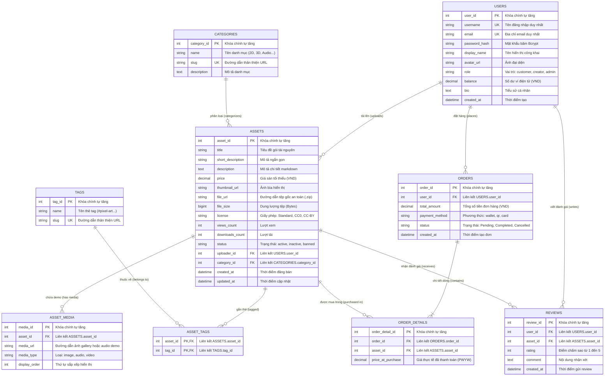
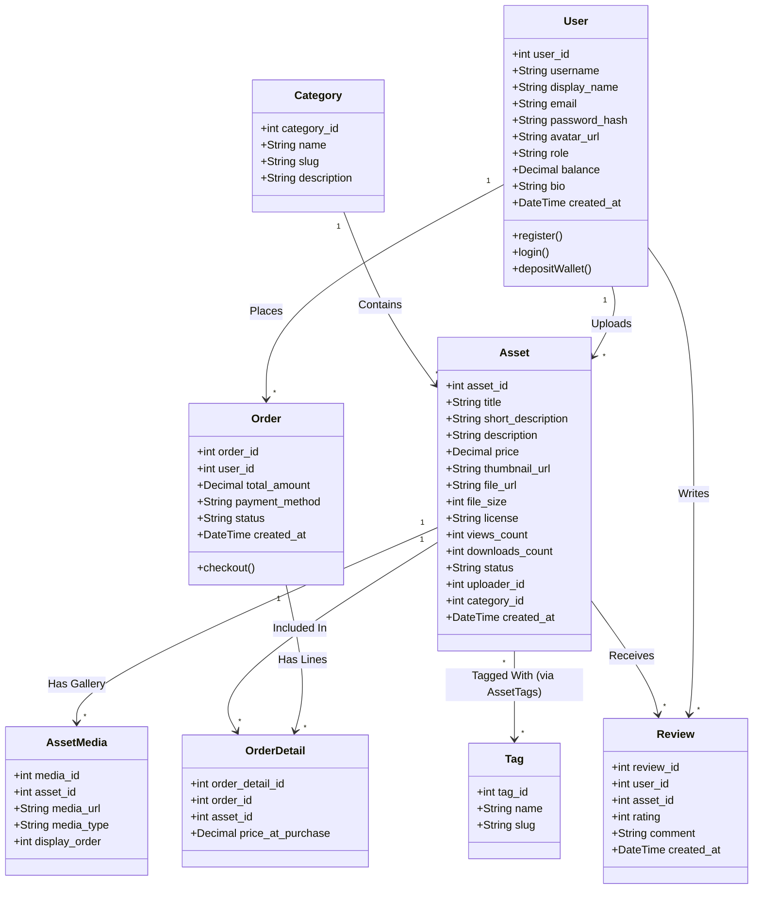

# THIẾT KẾ CƠ SỞ DỮ LIỆU & LƯỢC ĐỒ QUAN HỆ (DATABASE SPECIFICATION)
## HỆ QUẢN TRỊ CSDL: MYSQL 8.0 (CHUẨN 3NF, ERD & ACID)

> Tài liệu mô tả chi tiết 9 thực thể dữ liệu, từ điển dữ liệu (Data Dictionary), sơ đồ thực thể quan hệ (ERD), sơ đồ lớp UML và cơ chế đảm bảo tính toàn vẹn giao dịch ACID.

---

## 1. SƠ ĐỒ THỰC THỂ QUAN HỆ (ERD - ENTITY RELATIONSHIP DIAGRAM)

---

## 2. TỪ ĐIỂN DỮ LIỆU CHI TIẾT (DATA DICTIONARY - 9 BẢNG)

### 2.1. Bảng `users` (Quản lý người dùng & Ví)
| Tên Cột | Kiểu Dữ Liệu | Khóa | Nullable | Mặc định | Ý nghĩa nghiệp vụ |
| :--- | :--- | :---: | :---: | :--- | :--- |
| `user_id` | `INT` | **PK** | NOT NULL | `AUTO_INCREMENT` | Định danh người dùng |
| `username` | `VARCHAR(50)` | **UK** | NOT NULL | — | Tên đăng nhập tài khoản |
| `email` | `VARCHAR(100)` | **UK** | NOT NULL | — | Email liên hệ & nhận thông báo |
| `password_hash` | `VARCHAR(255)` | — | NOT NULL | — | Mật khẩu mã hóa Bcrypt (10 salt rounds) |
| `display_name` | `VARCHAR(100)` | — | NULL | NULL | Tên tác giả hiển thị công khai |
| `avatar_url` | `VARCHAR(255)` | — | NULL | NULL | Đường dẫn ảnh đại diện |
| `role` | `ENUM('customer','creator','admin')` | — | NOT NULL | `'customer'` | Phân quyền tài khoản RBAC |
| `balance` | `DECIMAL(12,2)` | — | NOT NULL | `0.00` | Số dư ví tiền GameAsset (VND) |
| `bio` | `TEXT` | — | NULL | NULL | Giới thiệu tóm tắt của Creator |
| `created_at` | `DATETIME` | — | NOT NULL | `CURRENT_TIMESTAMP` | Thời điểm tạo tài khoản |

### 2.2. Bảng `categories` (Danh mục tài nguyên)
| Tên Cột | Kiểu Dữ Liệu | Khóa | Nullable | Mặc định | Ý nghĩa nghiệp vụ |
| :--- | :--- | :---: | :---: | :--- | :--- |
| `category_id` | `INT` | **PK** | NOT NULL | `AUTO_INCREMENT` | Định danh danh mục |
| `name` | `VARCHAR(100)` | — | NOT NULL | — | Tên danh mục (*2D Assets, 3D Models, Audio...*) |
| `slug` | `VARCHAR(100)` | **UK** | NOT NULL | — | Đường dẫn URL thân thiện SEO |
| `description` | `TEXT` | — | NULL | NULL | Mô tả chi tiết phân loại |

### 2.3. Bảng `tags` (Thẻ gắn đa tiêu chí)
| Tên Cột | Kiểu Dữ Liệu | Khóa | Nullable | Mặc định | Ý nghĩa nghiệp vụ |
| :--- | :--- | :---: | :---: | :--- | :--- |
| `tag_id` | `INT` | **PK** | NOT NULL | `AUTO_INCREMENT` | Định danh thẻ tag |
| `name` | `VARCHAR(50)` | — | NOT NULL | — | Tên thẻ tag (*#pixel-art, #low-poly*) |
| `slug` | `VARCHAR(50)` | **UK** | NOT NULL | — | Slug phục vụ tìm kiếm bộ lọc |

### 2.4. Bảng `assets` (Thực thể trung tâm tài nguyên game)
| Tên Cột | Kiểu Dữ Liệu | Khóa | Nullable | Mặc định | Ý nghĩa nghiệp vụ |
| :--- | :--- | :---: | :---: | :--- | :--- |
| `asset_id` | `INT` | **PK** | NOT NULL | `AUTO_INCREMENT` | Định danh tài nguyên |
| `title` | `VARCHAR(150)` | — | NOT NULL | — | Tên gói tài nguyên đăng bán |
| `short_description`| `VARCHAR(255)` | — | NULL | NULL | Tóm tắt hiển thị trên card catalog |
| `description` | `TEXT` | — | NULL | NULL | Nội dung chi tiết định dạng Markdown |
| `price` | `DECIMAL(10,2)` | — | NOT NULL | `0.00` | Mức giá sàn tối thiểu (VND) |
| `thumbnail_url` | `VARCHAR(255)` | — | NULL | NULL | Ảnh bìa chính đại diện |
| `file_url` | `VARCHAR(255)` | — | NOT NULL | — | Đường dẫn tệp nén gốc (`.zip`) |
| `file_size` | `BIGINT` | — | NOT NULL | `0` | Kích thước tệp tin (Bytes) |
| `license` | `VARCHAR(50)` | — | NOT NULL | `'Standard'` | Bản quyền (*CC0, CC-BY, Commercial*) |
| `views_count` | `INT` | — | NOT NULL | `0` | Tổng lượt xem trang |
| `downloads_count` | `INT` | — | NOT NULL | `0` | Tổng số lượt tải về |
| `status` | `ENUM('active','inactive','banned')` | — | NOT NULL | `'active'` | Trạng thái hiển thị / kiểm duyệt |
| `uploader_id` | `INT` | **FK** | NOT NULL | — | Tác giả (tham chiếu `users.user_id`) |
| `category_id` | `INT` | **FK** | NOT NULL | — | Danh mục (tham chiếu `categories.category_id`) |
| `created_at` | `DATETIME` | — | NOT NULL | `CURRENT_TIMESTAMP` | Ngày đăng tải |
| `updated_at` | `DATETIME` | — | NOT NULL | `CURRENT_TIMESTAMP` | Ngày sửa đổi gần nhất |

### 2.5. Bảng `asset_media` (Gallery & Trình phát Audio Demo)
| Tên Cột | Kiểu Dữ Liệu | Khóa | Nullable | Mặc định | Ý nghĩa nghiệp vụ |
| :--- | :--- | :---: | :---: | :--- | :--- |
| `media_id` | `INT` | **PK** | NOT NULL | `AUTO_INCREMENT` | Định danh media |
| `asset_id` | `INT` | **FK** | NOT NULL | — | Thuộc về Asset (tham chiếu `assets.asset_id`) |
| `media_url` | `VARCHAR(255)` | — | NOT NULL | — | URL ảnh demo hoặc âm thanh nghe thử |
| `media_type` | `ENUM('image','audio','video')` | — | NOT NULL | `'image'` | Phân loại định dạng media xem trước |
| `display_order` | `INT` | — | NOT NULL | `0` | Thứ tự trình chiếu gallery |

### 2.6. Bảng `asset_tags` (Bảng trung gian N - N)
| Tên Cột | Kiểu Dữ Liệu | Khóa | Nullable | Mặc định | Ý nghĩa nghiệp vụ |
| :--- | :--- | :---: | :---: | :--- | :--- |
| `asset_id` | `INT` | **PK, FK** | NOT NULL | — | Tham chiếu `assets.asset_id` (ON DELETE CASCADE) |
| `tag_id` | `INT` | **PK, FK** | NOT NULL | — | Tham chiếu `tags.tag_id` (ON DELETE CASCADE) |

### 2.7. Bảng `orders` (Hóa đơn giao dịch)
| Tên Cột | Kiểu Dữ Liệu | Khóa | Nullable | Mặc định | Ý nghĩa nghiệp vụ |
| :--- | :--- | :---: | :---: | :--- | :--- |
| `order_id` | `INT` | **PK** | NOT NULL | `AUTO_INCREMENT` | Mã số hóa đơn |
| `user_id` | `INT` | **FK** | NOT NULL | — | Người mua (tham chiếu `users.user_id`) |
| `total_amount` | `DECIMAL(12,2)` | — | NOT NULL | — | Tổng tiền hóa đơn (VND) |
| `payment_method` | `ENUM('wallet','qr','card')` | — | NOT NULL | `'wallet'` | Phương thức thanh toán |
| `status` | `ENUM('Pending','Completed','Cancelled')` | — | NOT NULL | `'Completed'` | Trạng thái giao dịch |
| `created_at` | `DATETIME` | — | NOT NULL | `CURRENT_TIMESTAMP` | Thời điểm thanh toán |

### 2.8. Bảng `order_details` (Chi tiết đơn hàng & Quyền tải)
| Tên Cột | Kiểu Dữ Liệu | Khóa | Nullable | Mặc định | Ý nghĩa nghiệp vụ |
| :--- | :--- | :---: | :---: | :--- | :--- |
| `order_detail_id` | `INT` | **PK** | NOT NULL | `AUTO_INCREMENT` | Định danh dòng đơn hàng |
| `order_id` | `INT` | **FK** | NOT NULL | — | Hóa đơn (tham chiếu `orders.order_id`) |
| `asset_id` | `INT` | **FK** | NOT NULL | — | Sản phẩm được mua (tham chiếu `assets.asset_id`) |
| `price_at_purchase`| `DECIMAL(10,2)` | — | NOT NULL | — | Giá thanh toán thực tế (hỗ trợ Pay What You Want) |

### 2.9. Bảng `reviews` (Đánh giá & Chấm sao xác thực)
| Tên Cột | Kiểu Dữ Liệu | Khóa | Nullable | Mặc định | Ý nghĩa nghiệp vụ |
| :--- | :--- | :---: | :---: | :--- | :--- |
| `review_id` | `INT` | **PK** | NOT NULL | `AUTO_INCREMENT` | Định danh đánh giá |
| `user_id` | `INT` | **FK** | NOT NULL | — | Người đánh giá (tham chiếu `users.user_id`) |
| `asset_id` | `INT` | **FK** | NOT NULL | — | Sản phẩm được đánh giá (tham chiếu `assets.asset_id`) |
| `rating` | `TINYINT` | — | NOT NULL | `5` | Điểm sao chấm từ 1 đến 5 |
| `comment` | `TEXT` | — | NULL | NULL | Lời nhận xét chi tiết |
| `created_at` | `DATETIME` | — | NOT NULL | `CURRENT_TIMESTAMP` | Thời điểm đánh giá |

---

## 3. SƠ ĐỒ LỚP TỔNG THỂ (UML CLASS DIAGRAM)

---

## 4. CHIẾN LƯỢC TỐI ƯU HÓA TRUY VẤN (INDEXING STRATEGY)

Để tối ưu hóa thời gian phản hồi API và loại bỏ hiện tượng Full Table Scan khi lượng dữ liệu lớn:
1. **Chỉ mục tìm kiếm danh mục & trạng thái:**
   * `CREATE INDEX idx_assets_category_status ON assets(category_id, status);`
   * Tác dụng: Tăng tốc độ lọc tài nguyên theo danh mục trên trang Catalog.
2. **Chỉ mục xác thực quyền tải & IDOR:**
   * `CREATE INDEX idx_orderdetails_asset_order ON order_details(asset_id, order_id);`
   * `CREATE INDEX idx_orders_user_status ON orders(user_id, status);`
   * Tác dụng: Cho phép API `GET /api/assets/:id/download` và `GET /api/order/my-library` kiểm tra quyền sở hữu trong thời gian $< 5\text{ms}$.
3. **Chỉ mục tính toán Rating trung bình:**
   * `CREATE INDEX idx_reviews_asset_id ON reviews(asset_id);`
   * Tác dụng: Tính toán điểm sao trung bình của tài nguyên tức thì mà không khóa bảng.

---

## 5. TÍNH TOÀN VẸN VÀ GIAO DỊCH DỮ LIỆU (ACID TRANSACTIONS)

Hệ thống tuân thủ chặt chẽ 4 nguyên lý **ACID** của Hệ quản trị CSDL quan hệ:
- **Atomicity (Nguyên tử):** Khi mua một tài nguyên game, việc trừ tiền ví người mua, cộng tiền ví người bán và tạo bản ghi `orders` + `order_details` diễn ra trong một **Database Transaction**. Nếu một bước bị lỗi, toàn bộ thao tác tự động Rollback lại số dư ban đầu.
- **Consistency (Nhất quán):** Ràng buộc khóa ngoại (`FOREIGN KEY`) và kiểm tra số dư ví không được âm (`balance >= 0`).
- **Isolation (Cô lập):** Mức cô lập `READ COMMITTED` ngăn chặn đọc dữ liệu rác (Dirty Read) khi nhiều người cùng giao dịch.
- **Durability (Bền vững):** Mọi giao dịch hoàn tất được ghi xuống ổ đĩa vật lý của MySQL Server, không mất mát ngay cả khi mất điện đột ngột.
