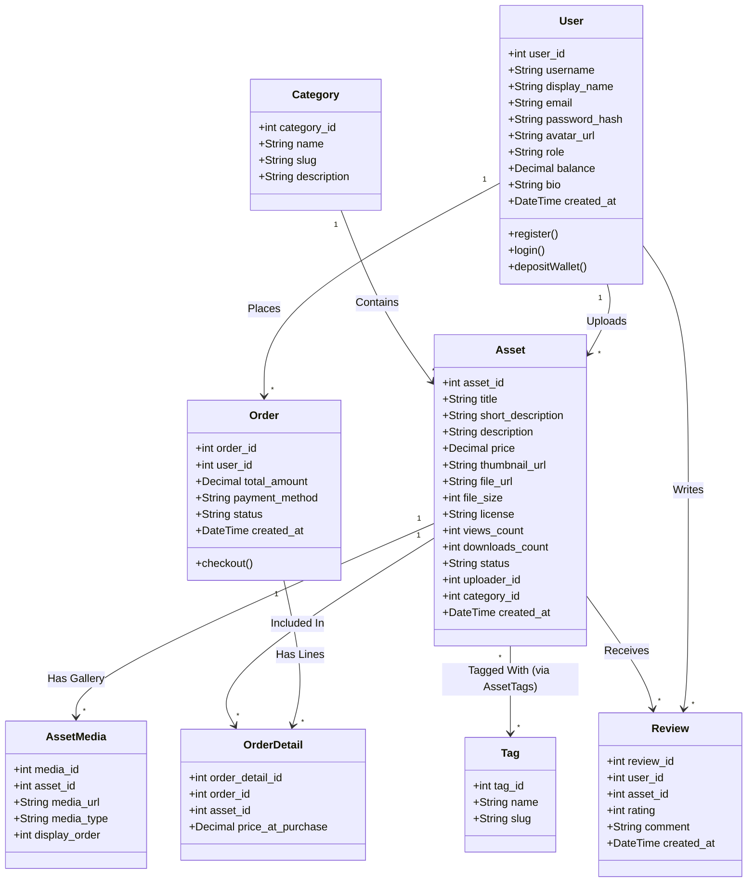

# THIẾT KẾ CƠ SỞ DỮ LIỆU & LƯỢC ĐỒ QUAN HỆ (DATABASE SPECIFICATION)
## HỆ QUẢN TRỊ CSDL: MYSQL 8.0 (CHUẨN 3NF & ACID)

> Tài liệu mô tả chi tiết 9 thực thể dữ liệu, cấu trúc bảng (Data Dictionary), sơ đồ lớp UML và mối quan hệ khóa ngoại (ERD).

---

## 1. DANH SÁCH 9 BẢNG TRONG CƠ SỞ DỮ LIỆU

| STT | Tên Bảng | Thuộc tính chính | Vai trò & Ý nghĩa nghiệp vụ |
| :---: | :--- | :--- | :--- |
| 1 | **`users`** | `user_id`, `username`, `email`, `password_hash`, `display_name`, `avatar_url`, `role`, `balance`, `bio`, `created_at` | Quản lý tài khoản, phân quyền (`customer`, `creator`, `admin`), mật khẩu băm Bcrypt và số dư ví điện tử cá nhân. |
| 2 | **`categories`** | `category_id`, `name`, `slug`, `description` | Danh mục cấp cao: *2D Assets*, *3D Models*, *Audio & SFX*, *GUI & Fonts*, *Game Templates*. |
| 3 | **`tags`** | `tag_id`, `name`, `slug` | Thẻ phân loại đa tiêu chí: phong cách (`#pixel-art`, `#low-poly`), góc nhìn (`#top-down`, `#side-scroller`). |
| 4 | **`assets`** | `asset_id`, `title`, `short_description`, `description`, `price`, `thumbnail_url`, `file_url`, `file_size`, `license`, `views_count`, `downloads_count`, `status`, `uploader_id`, `category_id` | **Thực thể trung tâm:** Chứa thông tin tài nguyên game, mức giá sàn, loại giấy phép bản quyền và đường dẫn file gốc. |
| 5 | **`asset_media`** | `media_id`, `asset_id`, `media_url`, `media_type`, `display_order` | Thư viện đa phương tiện xem trước: Nhiều ảnh chụp màn hình, ảnh động GIF nhân vật chạy/nhảy hoặc âm thanh nghe thử. |
| 6 | **`asset_tags`** | `asset_id`, `tag_id` | Bảng liên kết nhiều-nhiều (N-N) phục vụ bộ lọc tìm kiếm chéo đa điều kiện. |
| 7 | **`orders`** | `order_id`, `user_id`, `total_amount`, `payment_method`, `status`, `created_at` | Hóa đơn giao dịch mua tài nguyên hoặc nạp tiền ví điện tử. |
| 8 | **`order_details`** | `order_detail_id`, `order_id`, `asset_id`, `price_at_purchase` | Chi tiết từng tài nguyên trong đơn hàng, lưu vết giá tại thời điểm giao dịch. |
| 9 | **`reviews`** | `review_id`, `user_id`, `asset_id`, `rating`, `comment`, `created_at` | Đánh giá chấm sao 1-5 sao (Ràng buộc: Chỉ người đã mua tài nguyên mới được đánh giá). |

---

## 2. SƠ ĐỒ LỚP TỔNG THỂ (UML CLASS DIAGRAM)

---

## 3. TÍNH TOÀN VẸN VÀ GIAO DỊCH DỮ LIỆU (ACID TRANSACTIONS)

Hệ thống tuân thủ chặt chẽ 4 nguyên lý **ACID** của Hệ quản trị CSDL quan hệ:
- **Atomicity (Nguyên tử):** Khi mua một tài nguyên game, việc trừ tiền ví người mua, cộng tiền ví người bán và tạo bản ghi `orders` + `order_details` diễn ra trong một **Database Transaction**. Nếu một bước bị lỗi, toàn bộ thao tác tự động Rollback lại số dư ban đầu.
- **Consistency (Nhất quán):** Ràng buộc khóa ngoại (`FOREIGN KEY`) và kiểm tra số dư ví không được âm (`balance >= 0`).
- **Isolation (Cô lập):** Mức cô lập `READ COMMITTED` ngăn chặn đọc dữ liệu rác (Dirty Read) khi nhiều người cùng giao dịch.
- **Durability (Bền vững):** Mọi giao dịch hoàn tất được ghi xuống ổ đĩa vật lý của MySQL Server, không mất mát ngay cả khi mất điện đột ngột.
