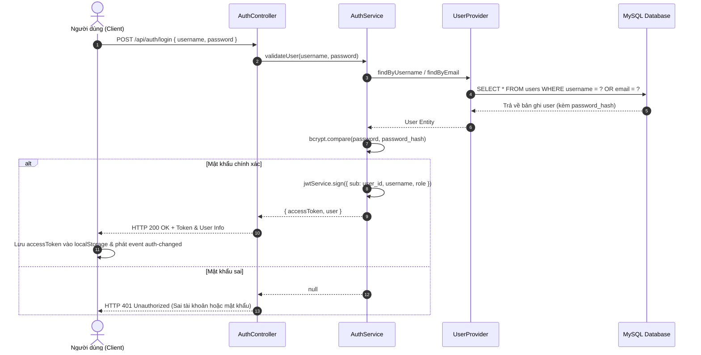
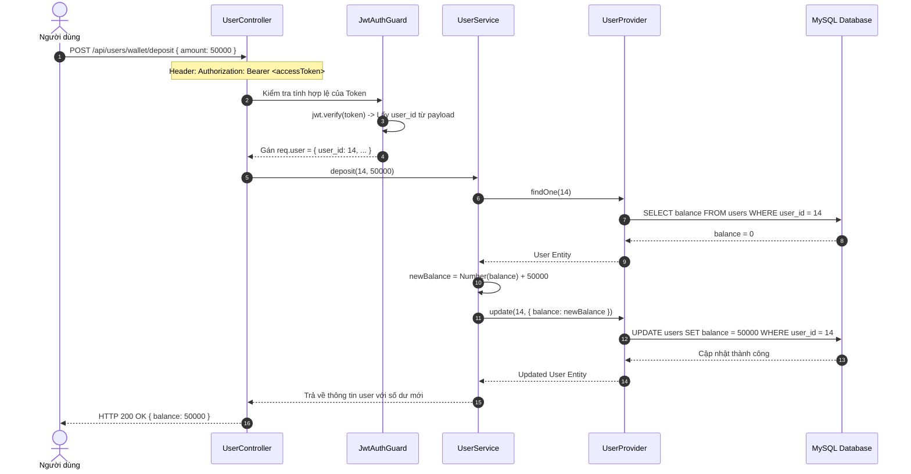
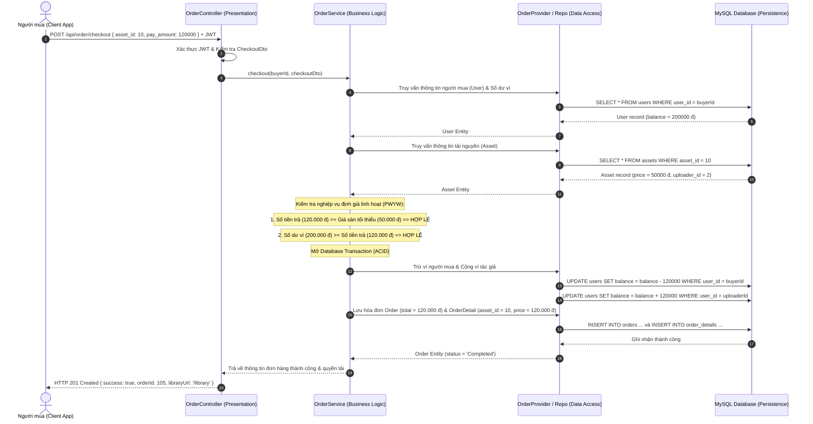

# SƠ ĐỒ TUẦN TỰ HỆ THỐNG (SEQUENCE DIAGRAMS)
## CÁC LUỒNG DỮ LIỆU ĐẶC TRƯNG CỦA SÀN TÀI NGUYÊN GAME

> Tài liệu mô tả các tương tác tuần tự giữa Client, Controllers, Services, Providers và Database theo chuẩn UML.

---

## 1. LUỒNG XÁC THỰC & ĐĂNG NHẬP (AUTHENTICATION FLOW)

---

## 2. LUỒNG NẠP TIỀN VÍ ĐIỆN TỬ (WALLET DEPOSIT FLOW)

---

## 3. LUỒNG MUA TÀI NGUYÊN (PAY WHAT YOU WANT & CHECKOUT FLOW)

