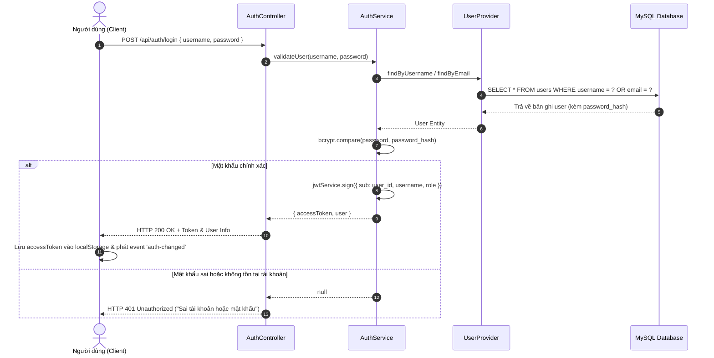
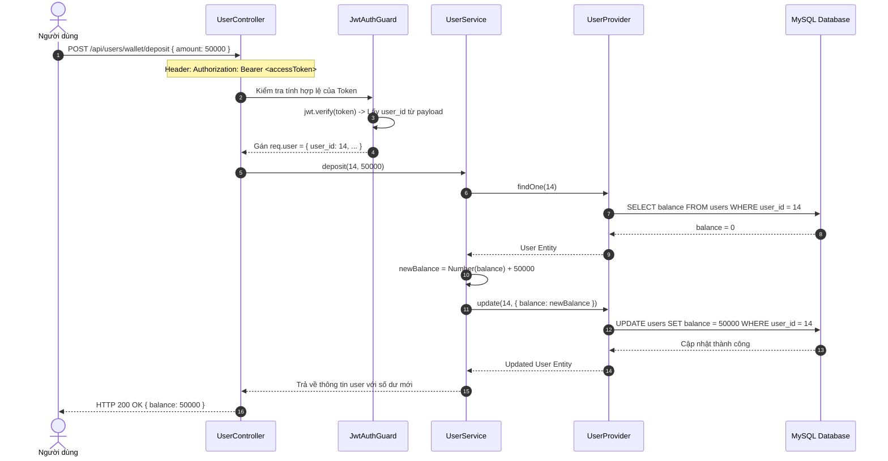
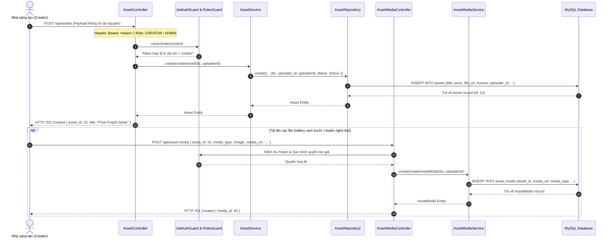
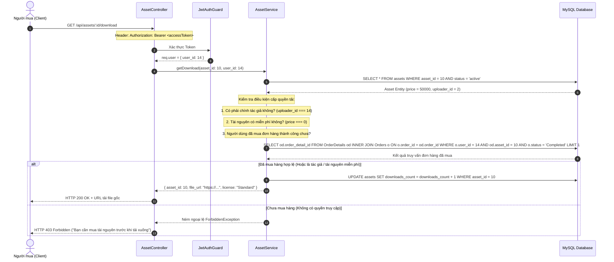
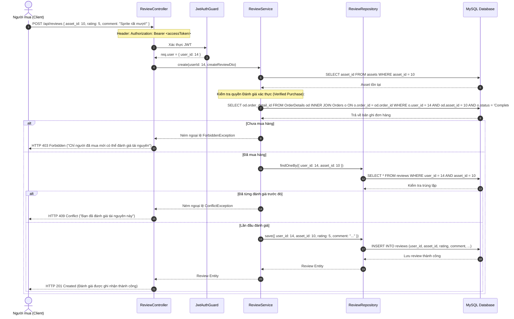
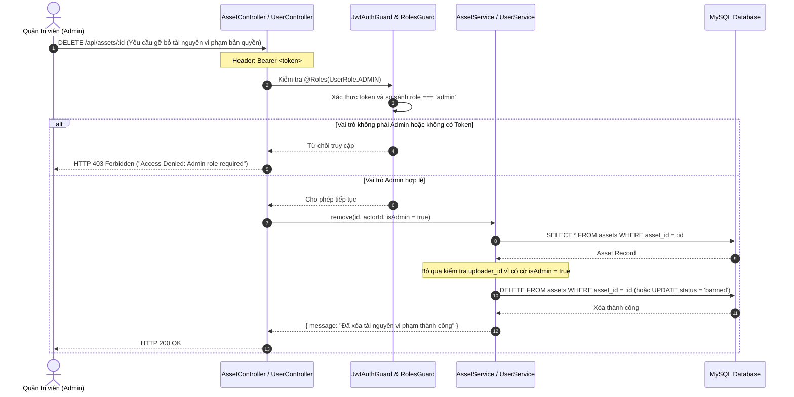

# SƠ ĐỒ TUẦN TỰ HỆ THỐNG (SEQUENCE DIAGRAMS)
## CÁC LUỒNG DỮ LIỆU ĐẶC TRƯNG CỦA SÀN TÀI NGUYÊN GAME (GAMEASSET)

> Tài liệu này mô tả chi tiết các tương tác tuần tự giữa **Client (Frontend)**, **Guards (Bảo mật RBAC)**, **Controllers (Presentation Tier)**, **Services (Business Logic Tier)**, **Providers/Repositories (Data Access Tier)** và **MySQL Database (Persistence Tier)** theo chuẩn phân tích thiết kế phần mềm UML 2.0.

---

### BẢNG ÁNH XẠ LUỒNG TUẦN TỰ THEO THÀNH VIÊN VÀ USE CASE

| STT | Luồng nghiệp vụ tuần tự | Tương ứng Use Case | Thành viên phụ trách chính | Mục tiêu kỹ thuật bảo vệ đồ án |
| :---: | :--- | :---: | :---: | :--- |
| **1** | **Xác thực & Cấp phát JWT** | `UC4` | **Nguyễn Trọng Hùng** | Băm mật khẩu bcrypt 10 rounds, mã hóa JWT payload, đồng bộ trạng thái Client. |
| **2** | **Nạp tiền vào ví điện tử** | `UC6` | **Nguyễn Trọng Hùng** | Xác thực `JwtAuthGuard`, kiểm tra DTO, cập nhật số dư ví trong giao dịch an toàn. |
| **3** | **Đăng bán & Upload tài nguyên** | `UC13` | **Bùi Quốc Toản** | Kiểm tra quyền Creator, lưu trữ thông tin sản phẩm và liên kết media demo. |
| **4** | **Thanh toán đơn hàng (PWYW Checkout)** | `UC7, UC8` | **Nguyễn Quốc Hưng** | Kiểm tra giá sàn PWYW, kiểm tra số dư ví, thực thi ACID Transaction trừ ví mua/cộng ví bán. |
| **5** | **Tải file gốc an toàn & Chặn IDOR** | `UC11` | **Bùi Quốc Toản & Nguyễn Quốc Hưng** | Ngăn chặn truy cập tệp lậu (IDOR defense), kiểm tra quyền sở hữu trong CSDL trước khi stream file. |
| **6** | **Đánh giá & Chấm sao xác thực** | `UC12` | **Phạm Văn Thắng** | Kiểm tra điều kiện "đã mua hàng" (Verified Review), chặn review trùng lặp, tính điểm sao trung bình. |
| **7** | **Quản trị & Kiểm duyệt vi phạm** | `UC17, UC18` | **Nguyễn Trọng Hùng** | Phân quyền RBAC (`RolesGuard`), gỡ bỏ sản phẩm vi phạm hoặc khóa người dùng. |

---

## 1. LUỒNG XÁC THỰC & ĐĂNG NHẬP (AUTHENTICATION FLOW - UC4)
* **Thành viên phụ trách:** Nguyễn Trọng Hùng
* **Ý nghĩa:** Định danh người dùng vào hệ thống, bảo vệ mật khẩu và cấp Token không lưu session phía server.

---

## 2. LUỒNG NẠP TIỀN VÍ ĐIỆN TỬ (WALLET DEPOSIT FLOW - UC6)
* **Thành viên phụ trách:** Nguyễn Trọng Hùng
* **Ý nghĩa:** Tăng số dư tài khoản phục vụ mua hàng linh hoạt không cần nhập thẻ nhiều lần.

---

## 3. LUỒNG ĐĂNG BÁN & UPLOAD TÀI NGUYÊN (ASSET & MEDIA CREATION - UC13)
* **Thành viên phụ trách:** Bùi Quốc Toản
* **Ý nghĩa:** Cho phép Creator niêm yết sản phẩm đồ họa/âm thanh, đính kèm link tải file gốc an toàn và gallery preview.

---

## 4. LUỒNG THANH TOÁN ĐƠN HÀNG & PWYW (PAY WHAT YOU WANT & CHECKOUT - UC7, UC8)
* **Thành viên phụ trách:** Nguyễn Quốc Hưng
* **Ý nghĩa:** Trọng tâm thương mại điện tử, áp dụng mô hình Pay What You Want và đảm bảo tính toàn vẹn số dư qua Database Transaction.

---

## 5. LUỒNG TẢI FILE GỐC AN TOÀN & CHẶN IDOR (SECURE FILE DOWNLOAD - UC11)
* **Thành viên phụ trách:** Bùi Quốc Toản & Nguyễn Quốc Hưng
* **Ý nghĩa:** Phòng vệ lỗ hổng IDOR (Insecure Direct Object Reference) - Kiểm tra tính hợp lệ của quyền sở hữu trong CSDL trước khi cho phép tải file nén `.zip` gốc.

---

## 6. LUỒNG ĐÁNH GIÁ & CHẤM SAO XÁC THỰC (VERIFIED REVIEW & RATING SYNC - UC12)
* **Thành viên phụ trách:** Phạm Văn Thắng
* **Ý nghĩa:** Ngăn chặn đánh giá rác (Spam Reviews). Chỉ người dùng đã thực sự sở hữu sản phẩm qua đơn hàng mới được phép gửi review và chấm sao.

---

## 7. LUỒNG QUẢN TRỊ & KIỂM DUYỆT VI PHẠM (ADMIN MODERATION - UC17, UC18)
* **Thành viên phụ trách:** Nguyễn Trọng Hùng
* **Ý nghĩa:** Bảo vệ nền tảng trước các nội dung độc hại, tệp tin vi phạm bản quyền DMCA hoặc tài khoản gian lận dựa trên Role-Based Access Control (RBAC).

