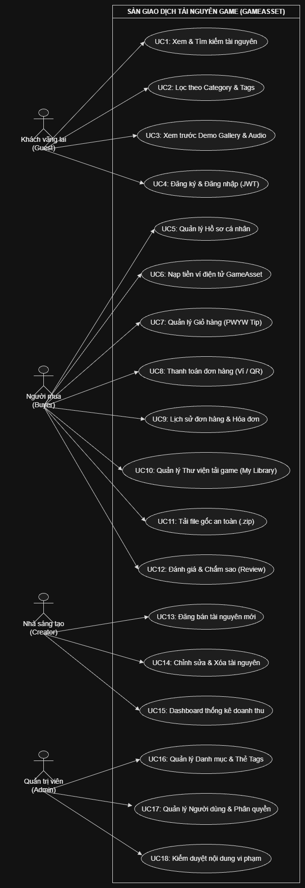

# ĐẶC TẢ CÁC CA SỬ DỤNG (USE CASE SPECIFICATION)
## SÀN GIAO DỊCH TÀI NGUYÊN GAME TRỰC TUYẾN (GAMEASSET)

> Tài liệu này mô tả chi tiết 4 tác nhân (Actors) và 18 ca sử dụng (Use Cases UC1 - UC18) của hệ thống theo chuẩn phân tích thiết kế phần mềm UML (Classic Draw.io / UML 2.0 Standard).

---

## 1. BIỂU ĐỒ USE CASE TỔNG THỂ (UML USE CASE DIAGRAM)

  
   
  <em>Hình 1: Sơ đồ Use Case tổng thể hệ thống Sàn giao dịch tài nguyên Game (GameAsset)</em>

---

### Mô hình hóa cấu trúc:
* **Bên ngoài (Trái):** 4 Tác nhân chính được bố trí dọc phân cấp từ trên xuống dưới:
  1. **👤 Khách vãng lai (Guest):** Người dùng duyệt tài nguyên công khai, chưa đăng nhập.
  2. **👤 Người mua (Buyer):** Người dùng sở hữu tài khoản và ví, thực hiện mua sắm và tải tài nguyên.
  3. **👤 Nhà sáng tạo (Creator):** Tác giả nội dung số, tải lên và quản lý sản phẩm bán.
  4. **👑 Quản trị viên (Admin):** Quản trị danh mục, phân quyền và kiểm duyệt toàn hệ thống.
* **Khung ranh giới hệ thống (System Boundary):** Chữ nhật dọc bao bọc toàn bộ 18 Ca sử dụng (`UC1` → `UC18`).
* **Đường liên kết hiệp hội (`---`):** Thể hiện quyền tương tác trực tiếp giữa từng Tác nhân và các Ca sử dụng tương ứng.

```mermaid
flowchart LR
    %% ================= 1. TÁC NHÂN BÊN TRÁI =================
    subgraph ACTORS ["TÁC NHÂN (ACTORS)"]
        direction TB
        Guest["👤 Khách vãng lai<br><i>(Guest)</i>"]
        Buyer["👤 Người mua<br><i>(Buyer)</i>"]
        Creator["👤 Nhà sáng tạo<br><i>(Creator)</i>"]
        Admin["👑 Quản trị viên<br><i>(Admin)</i>"]

        Guest ~~~ Buyer ~~~ Creator ~~~ Admin
    end

    %% ================= 2. KHUNG RANH GIỚI HỆ THỐNG =================
    subgraph SYSTEM ["📦 SÀN GIAO DỊCH TÀI NGUYÊN GAME (GAMEASSET)"]
        direction TB
        UC1(["UC1: Xem & Tìm kiếm tài nguyên"])
        UC2(["UC2: Lọc theo Category & Tags"])
        UC3(["UC3: Xem trước Demo Gallery & Audio"])
        UC4(["UC4: Đăng ký & Đăng nhập (JWT)"])

        UC5(["UC5: Quản lý Hồ sơ cá nhân"])
        UC6(["UC6: Nạp tiền ví điện tử GameAsset"])
        UC7(["UC7: Quản lý Giỏ hàng (PWYW Tip)"])
        UC8(["UC8: Thanh toán đơn hàng (Ví / QR)"])
        UC9(["UC9: Lịch sử đơn hàng & Hóa đơn"])
        UC10(["UC10: Quản lý Thư viện tải game (My Library)"])
        UC11(["UC11: Tải file gốc an toàn (.zip)"])
        UC12(["UC12: Đánh giá & Chấm sao (Review)"])

        UC13(["UC13: Đăng bán tài nguyên mới"])
        UC14(["UC14: Chỉnh sửa & Xóa tài nguyên"])
        UC15(["UC15: Dashboard thống kê doanh thu"])

        UC16(["UC16: Quản lý Danh mục & Thẻ Tags"])
        UC17(["UC17: Quản lý Người dùng & Phân quyền"])
        UC18(["UC18: Kiểm duyệt nội dung vi phạm"])

        UC1 ~~~ UC2 ~~~ UC3 ~~~ UC4 ~~~ UC5 ~~~ UC6 ~~~ UC7 ~~~ UC8 ~~~ UC9 ~~~ UC10 ~~~ UC11 ~~~ UC12 ~~~ UC13 ~~~ UC14 ~~~ UC15 ~~~ UC16 ~~~ UC17 ~~~ UC18
    end

    %% ================= 3. ĐƯỜNG KẾT NỐI (ASSOCIATIONS) =================
    %% Khách vãng lai (Guest)
    Guest --- UC1
    Guest --- UC2
    Guest --- UC3
    Guest --- UC4

    %% Người mua (Buyer)
    Buyer --- UC5
    Buyer --- UC6
    Buyer --- UC7
    Buyer --- UC8
    Buyer --- UC9
    Buyer --- UC10
    Buyer --- UC11
    Buyer --- UC12

    %% Nhà sáng tạo (Creator)
    Creator --- UC13
    Creator --- UC14
    Creator --- UC15

    %% Quản trị viên (Admin)
    Admin --- UC16
    Admin --- UC17
    Admin --- UC18

    %% ================= 4. ĐỊNH DẠNG MÀU SẮC CHUẨN UML =================
    classDef actor fill:#1e293b,stroke:#38bdf8,stroke-width:2px,color:#ffffff;
    classDef admin fill:#1e293b,stroke:#f59e0b,stroke-width:2px,color:#ffffff;
    classDef usecase fill:#0f172a,stroke:#38bdf8,stroke-width:1.5px,color:#ffffff;

    class Guest,Buyer,Creator actor;
    class Admin admin;
    class UC1,UC2,UC3,UC4,UC5,UC6,UC7,UC8,UC9,UC10,UC11,UC12,UC13,UC14,UC15,UC16,UC17,UC18 usecase;
    style SYSTEM fill:#0b1120,stroke:#64748b,stroke-width:2px,stroke-dasharray: 5 5,color:#38bdf8;
    style ACTORS fill:transparent,stroke:none;
```

<b>📐 Xem mã nguồn Mermaid Diagram (Tương thích 100% với Sơ đồ)</b> (Click để mở rộng)

---

## 2. MA TRẬN PHÂN QUYỀN VÀ TÁC NHÂN (ACTORS & PERMISSIONS MATRIX)

| Mã UC | Tên Ca Sử Dụng (Use Case) | Khách vãng lai (Guest) | Người mua (Buyer) | Nhà sáng tạo (Creator) | Quản trị viên (Admin) |
| :---: | :--- | :---: | :---: | :---: | :---: |
| **UC1** | Xem & Tìm kiếm tài nguyên | ✅ *(Trực tiếp)* | ✅ | ✅ | ✅ |
| **UC2** | Lọc theo Category & Tags | ✅ *(Trực tiếp)* | ✅ | ✅ | ✅ |
| **UC3** | Xem trước Demo Gallery & Audio | ✅ *(Trực tiếp)* | ✅ | ✅ | ✅ |
| **UC4** | Đăng ký & Đăng nhập (JWT) | ✅ *(Trực tiếp)* | — | — | — |
| **UC5** | Quản lý Hồ sơ cá nhân | ❌ | ✅ *(Trực tiếp)* | ✅ | ✅ |
| **UC6** | Nạp tiền ví điện tử GameAsset | ❌ | ✅ *(Trực tiếp)* | ❌ | ❌ |
| **UC7** | Quản lý Giỏ hàng (PWYW Tip) | ❌ | ✅ *(Trực tiếp)* | ❌ | ❌ |
| **UC8** | Thanh toán đơn hàng (Ví / QR) | ❌ | ✅ *(Trực tiếp)* | ❌ | ❌ |
| **UC9** | Lịch sử đơn hàng & Hóa đơn | ❌ | ✅ *(Trực tiếp)* | ❌ | ❌ |
| **UC10** | Quản lý Thư viện tải game (My Library) | ❌ | ✅ *(Trực tiếp)* | ❌ | ❌ |
| **UC11** | Tải file gốc an toàn (.zip) | ❌ | ✅ *(Trực tiếp)* | ✅ *(File của mình)* | ❌ |
| **UC12** | Đánh giá & Chấm sao (Review) | ❌ | ✅ *(Trực tiếp - Đã mua)* | ❌ | ❌ |
| **UC13** | Đăng bán tài nguyên mới | ❌ | ❌ | ✅ *(Trực tiếp)* | ❌ |
| **UC14** | Chỉnh sửa & Xóa tài nguyên | ❌ | ❌ | ✅ *(Trực tiếp - Của mình)* | ✅ *(Kiểm duyệt)* |
| **UC15** | Dashboard thống kê doanh thu | ❌ | ❌ | ✅ *(Trực tiếp)* | ✅ |
| **UC16** | Quản lý Danh mục & Thẻ Tags | ❌ | ❌ | ❌ | ✅ *(Trực tiếp)* |
| **UC17** | Quản lý Người dùng & Phân quyền | ❌ | ❌ | ❌ | ✅ *(Trực tiếp)* |
| **UC18** | Kiểm duyệt nội dung vi phạm | ❌ | ❌ | ❌ | ✅ *(Trực tiếp)* |

---

## 3. ĐẶC TẢ CHI TIẾT 18 CA SỬ DỤNG (USE CASE SPECIFICATIONS)

### Phân nhóm 1: Nhóm Khách vãng lai (Public Discovery)

#### UC1: Xem & Tìm kiếm tài nguyên
* **Tác nhân:** Khách vãng lai (Guest), Người mua (Buyer).
* **Mục tiêu:** Tra cứu các gói tài nguyên game (Sprites, 3D Models, Nhạc nền SFX) theo từ khóa.
* **Tiền điều kiện:** Người dùng truy cập hệ thống qua Web Browser.
* **Luồng chính:**
  1. Người dùng nhập từ khóa vào ô tìm kiếm trên thanh điều hướng hoặc trang Catalog.
  2. Hệ thống tìm kiếm theo tên tài nguyên, mô tả và trả về danh sách kết quả phù hợp kèm giá bán và đánh giá sao trung bình.
* **Hậu điều kiện:** Hiển thị danh sách kết quả trực quan (hỗ trợ phân trang và skeleton loading).

#### UC2: Lọc theo Category & Tags
* **Tác nhân:** Khách vãng lai (Guest), Người mua (Buyer).
* **Mục tiêu:** Thu hẹp phạm vi tìm kiếm theo phân loại chính (2D, 3D, Audio, UI) và thẻ kỹ thuật (`#pixel-art`, `#low-poly`, `#unity`, `#unreal`).
* **Luồng chính:** Người dùng chọn danh mục hoặc nhấp chọn các tag từ bộ lọc đa tiêu chí; hệ thống cập nhật kết quả theo thời gian thực (Reactive state).

#### UC3: Xem trước Demo Gallery & Audio
* **Tác nhân:** Khách vãng lai (Guest), Người mua (Buyer).
* **Mục tiêu:** Trải nghiệm chất lượng đồ họa và nghe thử âm thanh trước khi quyết định mua.
* **Luồng chính:**
  1. Người dùng mở trang chi tiết tài nguyên (`/assets/:id`).
  2. Người dùng xem ảnh chất lượng cao dạng Lightbox, xem ảnh động GIF chuyển động hoạt ảnh sprite.
  3. Với tài nguyên Audio: Người dùng bấm Play để nghe thử trích đoạn mẫu trực tiếp trên trình phát web mà không thể tải file gốc.

#### UC4: Đăng ký & Đăng nhập (JWT)
* **Tác nhân:** Khách vãng lai (Guest).
* **Mục tiêu:** Định danh người dùng vào hệ thống để mua hàng hoặc bán tài nguyên.
* **Luồng chính:**
  1. Người dùng mở modal Đăng ký hoặc Đăng nhập, nhập Email và Mật khẩu.
  2. Backend xác thực mật khẩu qua mã hóa bcrypt (10 rounds).
  3. Hệ thống cấp phát cặp Token: **Access Token (JWT ngắn hạn)** lưu ở client và trả về dữ liệu User Profile.

---

### Phân nhóm 2: Nhóm Người mua & Khách hàng (Buyer Commerce)

#### UC5: Quản lý Hồ sơ cá nhân
* **Tác nhân:** Người mua (Buyer), Nhà sáng tạo (Creator).
* **Mục tiêu:** Cập nhật thông tin hiển thị, ảnh đại diện (avatar), tiểu sử và đổi mật khẩu bảo mật.
* **Tiền điều kiện:** Đã đăng nhập hệ thống (`Authorization: Bearer <token>`).

#### UC6: Nạp tiền ví điện tử GameAsset
* **Tác nhân:** Người mua (Buyer).
* **Mục tiêu:** Bổ sung số dư vào ví tài khoản GameAsset để thanh toán tức thì mà không cần nhập thẻ ngân hàng mỗi lần mua lẻ.
* **Luồng chính:**
  1. Người dùng chọn nạp tiền tại trang Hồ sơ hoặc Giỏ hàng.
  2. Chọn mệnh giá nạp (50.000 đ, 100.000 đ, 200.000 đ, 500.000 đ).
  3. Quét mã QR chuyển khoản hoặc xác nhận demo nạp tiền.
  4. Hệ thống cập nhật số dư ví trong giao dịch CSDL (ACID transaction).

#### UC7: Quản lý Giỏ hàng (PWYW Tip)
* **Tác nhân:** Người mua (Buyer).
* **Mục tiêu:** Thêm/bớt nhiều tài nguyên vào giỏ hàng và tùy chỉnh số tiền ủng hộ thêm cho tác giả theo mô hình **Pay What You Want (PWYW)**.
* **Luồng chính:**
  1. Người dùng bấm "Thêm vào giỏ" trên trang chi tiết tài nguyên.
  2. Vào trang Giỏ hàng (`/cart`), hệ thống hiển thị giá sàn tối thiểu.
  3. Người dùng có thể tùy chỉnh tăng số tiền thanh toán (Ví dụ: giá sàn 25.000 đ, người dùng trả 50.000 đ để tip thêm cho Creator).
  4. Hệ thống tự động tính toán tổng tiền thanh toán theo thời gian thực.

#### UC8: Thanh toán đơn hàng (Ví / QR)
* **Tác nhân:** Người mua (Buyer).
* **Mục tiêu:** Hoàn tất đơn hàng và nhận quyền sở hữu vĩnh viễn tài nguyên.
* **Tiền điều kiện:** Giỏ hàng có sản phẩm, số dư ví $\ge$ Tổng tiền đơn hàng hoặc thanh toán QR.
* **Luồng chính:**
  1. Người dùng nhấn "Thanh toán ngay" tại trang Checkout.
  2. Backend mở transaction CSDL:
     - Khấu trừ số dư ví người mua.
     - Cộng số dư tương ứng cho các tác giả (Creator) của từng sản phẩm.
     - Tạo bản ghi đơn hàng (`orders`) và các dòng chi tiết đơn hàng (`order_items`).
  3. Hệ thống xóa rỗng giỏ hàng và chuyển hướng sang trang Hoàn tất đơn hàng.

#### UC9: Lịch sử đơn hàng & Hóa đơn
* **Tác nhân:** Người mua (Buyer).
* **Mục tiêu:** Tra cứu lại các đơn hàng đã thanh toán trong quá khứ, mã đơn hàng, ngày mua, số tiền đã trả và chi tiết từng sản phẩm.

#### UC10: Quản lý Thư viện tải game (My Library)
* **Tác nhân:** Người mua (Buyer).
* **Mục tiêu:** Quản lý kho tài nguyên số đã sở hữu vĩnh viễn (`/my-library`).
* **Luồng chính:**
  1. Người dùng mở mục "Thư viện của tôi".
  2. Hệ thống truy vấn API `GET /api/order/my-library` lấy toàn bộ tài nguyên trong các đơn hàng thành công.
  3. Hiển thị thẻ tài nguyên kèm dung lượng file, định dạng tệp và nút "Tải xuống".

#### UC11: Tải file gốc an toàn (.zip)
* **Tác nhân:** Người mua (Buyer), Nhà sáng tạo (chính tác giả).
* **Mục tiêu:** Tải tệp nén mã nguồn/tài nguyên gốc chất lượng cao (`.zip`, `.unitypackage`).
* **Cơ chế bảo mật (IDOR Mitigation):**
  1. Client gửi yêu cầu tải file: `GET /api/asset-media/:id/download`.
  2. Server kiểm tra trong CSDL: User này có phải tác giả (Creator) hoặc đã sở hữu trong đơn hàng hợp lệ chưa.
  3. Nếu hợp lệ: Server cấp phát stream tải file. Nếu chưa mua: Server trả về lỗi `403 Forbidden`.

#### UC12: Đánh giá & Chấm sao (Review)
* **Tác nhân:** Người mua (Buyer).
* **Mục tiêu:** Chấm điểm từ 1 đến 5 sao và viết nhận xét về tài nguyên.
* **Quy tắc nghiệp vụ:** Chỉ những người mua đã sở hữu sản phẩm (Verified Purchase) mới có quyền gửi đánh giá để đảm bảo tính khách quan và uy tín của sàn.

---

### Phân nhóm 3: Nhóm Nhà sáng tạo (Creator Studio)

#### UC13: Đăng bán tài nguyên mới
* **Tác nhân:** Nhà sáng tạo (Creator).
* **Mục tiêu:** Tải lên gói tài nguyên game mới để bán hoặc chia sẻ miễn phí trên sàn.
* **Luồng chính:**
  1. Tác giả mở trang "Đăng tài nguyên" (`/creator/upload`).
  2. Điền thông tin: Tiêu đề, Danh mục, Thẻ tag, Giá bán tối thiểu (VND), Loại bản quyền (Standard, CC0, Commercial).
  3. Tải lên tệp tin gốc (`.zip`) và bộ sưu tập ảnh/âm thanh preview.
  4. Hệ thống lưu trữ và niêm yết tài nguyên lên chợ.

#### UC14: Chỉnh sửa & Xóa tài nguyên
* **Tác nhân:** Nhà sáng tạo (Creator), Quản trị viên (Admin).
* **Mục tiêu:** Cập nhật thông tin mô tả, điều chỉnh giá bán, tải lên phiên bản cập nhật (v1.1, v2.0) hoặc gỡ sản phẩm khi ngừng kinh doanh.
* **Ràng buộc:** Creator chỉ được phép chỉnh sửa tài nguyên do chính mình đăng tải (`creator_id == current_user.id`).

#### UC15: Dashboard thống kê doanh thu
* **Tác nhân:** Nhà sáng tạo (Creator).
* **Mục tiêu:** Theo dõi hiệu quả kinh doanh của các gói tài nguyên.
* **Thông số cung cấp:**
  - Tổng doanh thu tích lũy và số dư ví có thể rút.
  - Tổng số lượt tải (Downloads) theo từng tuần/tháng.
  - Top tài nguyên bán chạy nhất và bảng đánh giá từ khách hàng.

---

### Phân nhóm 4: Nhóm Quản trị viên (System Administration)

#### UC16: Quản lý Danh mục & Thẻ Tags
* **Tác nhân:** Quản trị viên (Admin).
* **Mục tiêu:** Tạo mới, sửa đổi hoặc xóa danh mục cha/con và chuẩn hóa bộ tag hệ thống để duy trì cấu trúc tìm kiếm khoa học.

#### UC17: Quản lý Người dùng & Phân quyền
* **Tác nhân:** Quản trị viên (Admin).
* **Mục tiêu:** Xem danh sách toàn bộ tài khoản, thay đổi vai trò (User $\leftrightarrow$ Creator $\leftrightarrow$ Admin), kích hoạt hoặc khóa tài khoản có hành vi gian lận.

#### UC18: Kiểm duyệt nội dung vi phạm
* **Tác nhân:** Quản trị viên (Admin).
* **Mục tiêu:** Xử lý các báo cáo vi phạm bản quyền (DMCA), nội dung độc hại hoặc tệp tin bị nghi ngờ chứa mã độc nhằm bảo vệ sự an toàn cho toàn bộ hệ sinh thái GameAsset.
