# ĐẶC TẢ CÁC CA SỬ DỤNG (USE CASE SPECIFICATION)
## SÀN GIAO DỊCH TÀI NGUYÊN GAME TRỰC TUYẾN

> Tài liệu này mô tả chi tiết các tác nhân (Actors) và các kịch bản sử dụng (Use Cases) của hệ thống theo chuẩn phân tích thiết kế phần mềm.

---

## 1. BIỂU ĐỒ USE CASE TỔNG THỂ (UML USE CASE DIAGRAM)

```mermaid
graph TD
    classDef actorStyle fill:#2d3748,stroke:#4a5568,stroke-width:2px,color:#fff;
    classDef usecaseStyle fill:#1a202c,stroke:#e53e3e,stroke-width:1.5px,color:#edf2f7;

    Guest["Khách vãng lai (Guest)"]:::actorStyle
    Customer["Người mua (Buyer/Customer)"]:::actorStyle
    Creator["Nhà sáng tạo (Creator)"]:::actorStyle
    Admin["Quản trị viên (Admin)"]:::actorStyle

    subgraph "HỆ THỐNG SÀN GIAO DỊCH TÀI NGUYÊN GAME"
        UC1(["Xem & Tìm kiếm tài nguyên"]):::usecaseStyle
        UC2(["Lọc đa chiều theo Tags & Category"]):::usecaseStyle
        UC3(["Xem trước Demo Gallery (Ảnh/GIF/Audio)"]):::usecaseStyle
        UC4(["Đăng ký / Đăng nhập (JWT)"]):::usecaseStyle
        
        UC5(["Nạp tiền vào ví điện tử"]):::usecaseStyle
        UC6(["Mua tài nguyên (Ủng hộ PWYW)"]):::usecaseStyle
        UC7(["Quản lý Thư viện cá nhân (My Library)"]):::usecaseStyle
        UC8(["Tải tệp tin gốc an toàn (Stream File)"]):::usecaseStyle
        UC9(["Đánh giá & Chấm sao (Verified Review)"]):::usecaseStyle

        UC10(["Đăng bán tài nguyên mới (Upload File/Media)"]):::usecaseStyle
        UC11(["Quản lý giá bán & Giấy phép bản quyền"]):::usecaseStyle
        UC12(["Bảng điều khiển tác giả (Dashboard Doanh thu)"]):::usecaseStyle

        UC13(["Quản lý Danh mục & Thẻ Tags"]):::usecaseStyle
        UC14(["Kiểm duyệt nội dung & Quản lý người dùng"]):::usecaseStyle
    end

    Guest --> UC1
    Guest --> UC2
    Guest --> UC3
    Guest --> UC4

    Customer --> UC1
    Customer --> UC2
    Customer --> UC3
    Customer --> UC5
    Customer --> UC6
    Customer --> UC7
    Customer --> UC8
    Customer --> UC9

    Creator --> UC10
    Creator --> UC11
    Creator --> UC12

    Admin --> UC13
    Admin --> UC14
```

---

## 2. PHÂN TÍCH CHI TIẾT TỪNG TÁC NHÂN (ACTORS)

### 2.1. Khách vãng lai (Guest)
- Người dùng chưa đăng nhập vào hệ thống.
- **Quyền hạn:**
  - Duyệt trang chủ, khám phá các gói tài nguyên nổi bật.
  - Tìm kiếm game, tài nguyên theo từ khóa, danh mục (2D, 3D, Audio) và thẻ tag (`#pixel-art`, `#roguelike`).
  - Xem trước demo đa phương tiện (ảnh GIF chuyển động nhân vật, nghe thử nhạc SFX).
  - Đăng ký tài khoản mới hoặc Đăng nhập.

### 2.2. Khách mua / Nhà phát triển (Buyer / Customer)
- Kế thừa toàn bộ quyền của Khách vãng lai sau khi xác thực thành công bằng JWT.
- **Quyền hạn bổ sung:**
  - **Quản lý Ví điện tử:** Nạp tiền vào ví cá nhân theo các mức cố định hoặc tùy chọn.
  - **Mua tài nguyên linh hoạt:** Áp dụng mô hình **Pay What You Want (PWYW)** — có quyền trả thêm tiền trên mức giá sàn để ủng hộ tác giả.
  - **Thư viện cá nhân (My Library):** Sở hữu vĩnh viễn các gói tài nguyên đã mua, được phép tải lại file bất cứ lúc nào.
  - **Tải file an toàn:** Nhận luồng file nén gốc thông qua cơ chế kiểm duyệt quyền sở hữu từ server.
  - **Đánh giá xác thực (Verified Review):** Chấm điểm 1-5 sao và để lại nhận xét công khai nếu đã sở hữu tài nguyên.

### 2.3. Nhà sáng tạo / Nghệ sĩ (Creator / Artist)
- Người dùng đăng ký với vai trò sáng tạo nội dung số.
- **Quyền hạn:**
  - Đăng bán gói tài nguyên mới: Tải lên tệp tin nén gốc (`.zip`), ảnh bìa, gallery ảnh chụp màn hình, ảnh động GIF, file nghe thử.
  - Thiết lập giá bán tối thiểu (Minimum Price) hoặc cho phép tải miễn phí ($0.00).
  - Lựa chọn loại giấy phép bản quyền (CC0, CC-BY, Commercial License).
  - Theo dõi số dư ví tiền kiếm được từ việc bán tài nguyên và nhận donate.

### 2.4. Quản trị viên (Admin)
- Người nắm quyền tối cao trong hệ thống.
- **Quyền hạn:**
  - Quản lý danh mục cấp cao (Categories) và cây thẻ gắn (Tags).
  - Quản lý và kiểm duyệt người dùng, khóa tài khoản vi phạm bản quyền hoặc gian lận.
  - Xem báo cáo tổng quan toàn hệ thống.
